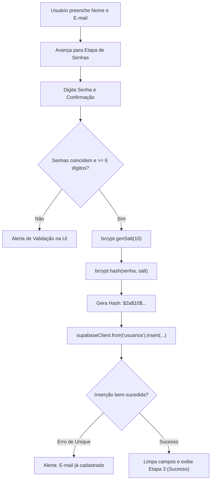
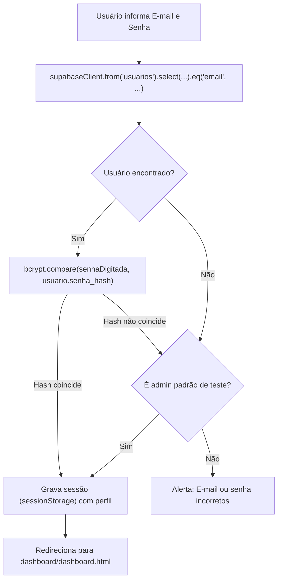

# 📋 Documento Técnico de Alterações: Autenticação, Bcrypt e Supabase
**Projeto:** BarberFlow (Grupo 05)  
**Instituição:** Faculdade Senac Distrito Federal  
**Disciplina:** Laboratório de Inovação II — Prof. Edilberto Silva (2026)  
**Módulo:** `RF-004-catalogo-de-servicos/app`  
**Data:** 18/10/2026  

---

## 1. 🎯 Objetivo da Intervenção

Transformar o protótipo de login e cadastro do BarberFlow — que anteriormente utilizava validação em memória volátil com senha em texto puro — em uma **solução segura, persistente e integrada a um banco de dados real**, utilizando:
1. **Criptografia Unidirecional (Hash) com `bcrypt`** para proteção de senhas.
2. **Integração com Supabase (PostgreSQL)** como Backend-as-a-Service via CDN em JavaScript puro.
3. **Controle de Acesso Baseado em Perfis (RBAC)** (`admin` vs `cliente`).

---

## 2. 🔍 Diagnóstico do Código Inicial (Problemas Identificados)

Antes das alterações, o sistema apresentava as seguintes limitações técnicas:
* **Senhas em texto puro:** A senha era atribuída diretamente à variável `senhaSalva = senha`, expondo credenciais diretamente na memória do navegador.
* **Persistência volátil:** As variáveis `emailSalvo` e `senhaSalva` eram resetadas a cada atualização (<kbd>F5</kbd>) da página.
* **Inconsistência de código:** A função `verificarSenhas()` havia sido removida acidentalmente e a função `fazerLogin()` estava duplicada.
* **Violação de Constraint no Banco:** A tabela `usuarios` no Supabase exige a coluna `nome` como `NOT NULL`, mas o formulário HTML inicial possuía apenas o campo de e-mail.

---

## 3. 📦 Bibliotecas Integradas (via CDN)

Foram incorporadas duas bibliotecas oficiais sem necessidade de empacotadores (Webpack/Vite), rodando em JavaScript puro diretamente no navegador:

| Biblioteca | Versão | CDN | Finalidade |
| :--- | :---: | :--- | :--- |
| **`@supabase/supabase-js`** | `v2` | `https://cdn.jsdelivr.net/npm/@supabase/supabase-js@2` | Comunicação assíncrona com o PostgreSQL do Supabase (operações de `INSERT` e `SELECT`). |
| **`bcryptjs`** | `v2.4.3` | `https://cdn.jsdelivr.net/npm/bcryptjs@2.4.3/dist/bcrypt.min.js` | Geração de salt, hashing irreversível e comparação assíncrona de senhas. |

---

## 4. 🛠️ Detalhamento das Alterações por Arquivo

### 4.1. Arquivo: `RF-004-catalogo-de-servicos.html`

* **Caminho:** `src/prototipos/SEMANA-06/RF-004-catalogo-de-servicos/app/RF-004-catalogo-de-servicos.html`

#### A. Inclusão das tags de script
Foram adicionados os scripts do Supabase e do bcryptjs imediatamente antes de `app.js`:
```html
<!-- Supabase JS Client (via CDN) -->
<script src="https://cdn.jsdelivr.net/npm/@supabase/supabase-js@2"></script>

<!-- bcryptjs (via CDN) -->
<script src="https://cdn.jsdelivr.net/npm/bcryptjs@2.4.3/dist/bcrypt.min.js"></script>

<script src="app.js"></script>
```

#### B. Inclusão do campo "Nome" no Cadastro (Etapa 1)
Para cumprir a restrição `NOT NULL` da coluna `nome` no Supabase:
```html
<div class="etapa etapa_1">
    <p>Crie sua Conta</p>
    <!-- Novo campo adicionado -->
    <label for="nome_cadastro">Nome</label>
    <input class="input" id="nome_cadastro" name="nome" type="text" placeholder="Seu nome completo" required>

    <label for="email_cadastro">E-mail</label>
    <input class="input" id="email_cadastro" name="email" type="email" placeholder="seu@email.com" autocomplete="email" required>
    <button class="btn_avancar" type="button" onclick="validarEmailCadastro()"> Avançar </button>
</div>
```

---

### 4.2. Arquivo: `app.js`

* **Caminho:** `src/prototipos/SEMANA-06/RF-004-catalogo-de-servicos/app/app.js`

#### A. Inicialização do Cliente Supabase
Configuração da URL do projeto e da chave de publicação (*anon key*):
```javascript
const SUPABASE_URL = "https://qqxntkifbvzcneaqbhae.supabase.co";
const SUPABASE_ANON_KEY = "sb_publishable_FjIQ8xTPK0Y7TrMxlknn-A_48rvJyeD";
const supabaseClient = window.supabase.createClient(SUPABASE_URL, SUPABASE_ANON_KEY);
```

#### B. Armazenamento temporário dos dados de cadastro
```javascript
let nomeSalvo = "";
let emailSalvo = "";
let senhaHashSalva = ""; // Armazena apenas o hash criptografado
```

#### C. Atualização da função `validarEmailCadastro()`
Passou a capturar e validar o campo `nome` em conjunto com o `email`:
```javascript
function validarEmailCadastro() {
    let nomeInput = document.getElementById("nome_cadastro");
    let nome = nomeInput ? nomeInput.value.trim() : "";
    let email = document.getElementById("email_cadastro").value.trim();
    let formatoValido = email.includes("@") && email.includes(".");

    if (nomeInput && nome === "") {
        alert("Por favor, preencha o seu nome.");
        return;
    }
    if (email === "") {
        alert("Por favor, preencha o e-mail.");
        return;
    }
    if (!formatoValido) {
        alert("Por favor, insira um e-mail válido.");
        return;
    }

    nomeSalvo = nome || email.split('@')[0];
    emailSalvo = email;

    document.querySelector(".etapa_1").style.display = "none";
    document.querySelector(".etapa_2").style.display = "flex";
}
```

#### D. Implementação da Criptografia e Inserção no Supabase em `verificarSenhas()`
1. Gera um salt de 10 rounds computacionais (`dcodeIO.bcrypt.genSalt(10)`).
2. Gera o hash bcrypt irreversível da senha (`dcodeIO.bcrypt.hash(senha, salt)`).
3. Executa a inserção assíncrona na tabela `usuarios` do Supabase com tratamento de duplicidade de e-mail (código de erro `23505`).
4. Limpa os campos de senha do DOM após a conclusão por segurança.

```javascript
async function verificarSenhas() {
    let senha = document.getElementById("senha_cadastro").value;
    let confirmacao = document.getElementById("confirmacao_senha").value;

    if (senha !== confirmacao) {
        alert("As senhas não coincidem! Tente novamente.");
        return;
    }
    if (senha.length < 6) {
        alert("A senha deve ter pelo menos 6 caracteres.");
        return;
    }

    try {
        // Criptografia com bcrypt
        const salt = await dcodeIO.bcrypt.genSalt(10);
        senhaHashSalva = await dcodeIO.bcrypt.hash(senha, salt);

        console.log("🔒 Senha criptografada com sucesso!");
        console.log("Hash bcrypt gerado:", senhaHashSalva);

        // Persistência no banco de dados Supabase
        const { data, error } = await supabaseClient
            .from('usuarios')
            .insert([
                {
                    nome: nomeSalvo || emailSalvo.split('@')[0],
                    email: emailSalvo,
                    senha_hash: senhaHashSalva,
                    perfil: 'cliente'
                }
            ]);

        if (error) {
            console.error("Erro Supabase:", error);
            if (error.code === '23505' || error.message.includes('unique') || error.message.includes('duplicate')) {
                alert("Este e-mail já está cadastrado no sistema!");
            } else {
                alert("Erro ao salvar no banco Supabase: " + error.message);
            }
            return;
        }

        console.log("✅ Usuário gravado com sucesso no Supabase!");

        document.getElementById("senha_cadastro").value = "";
        document.getElementById("confirmacao_senha").value = "";

        document.querySelector(".etapa_2").style.display = "none";
        document.querySelector(".etapa_3").style.display = "flex";
    } catch (erro) {
        alert("Erro ao processar o cadastro.");
        console.error(erro);
    }
}
```

#### E. Autenticação Segura com Bcrypt e Supabase em `fazerLogin()`
1. Busca o registro no banco pelo e-mail informado: `.select('*').eq('email', emailDigitado).maybeSingle()`.
2. Se o usuário existir, compara a senha digitada contra o hash armazenado usando `dcodeIO.bcrypt.compare()`.
3. Registra logs no console (<kbd>F12</kbd>) demonstrando a recuperação do hash e a validação do bcrypt.
4. Suporta a credencial administrativa de desenvolvimento (`admin@teste.com`).
5. Grava os dados do usuário autenticado no `sessionStorage` para consumo pelo Dashboard.

```javascript
async function fazerLogin() {
    let emailDigitado = document.getElementById("email_login").value.trim();
    let senhaDigitada = document.getElementById("senha").value;

    if (emailDigitado === "" || senhaDigitada === "") {
        alert("Por favor, preencha o e-mail e a senha!");
        return;
    }

    try {
        // Consulta no banco
        const { data: usuario, error } = await supabaseClient
            .from('usuarios')
            .select('*')
            .eq('email', emailDigitado)
            .maybeSingle();

        if (error) {
            console.error("Erro ao consultar Supabase:", error);
            alert("Erro na conexão com o banco de dados: " + error.message);
            return;
        }

        let senhaValida = false;

        // Validação criptográfica com bcrypt
        if (usuario && usuario.senha_hash) {
            console.log("🔍 Usuário encontrado no Supabase:", usuario.email);
            console.log("🔑 Hash armazenado no banco:", usuario.senha_hash);
            senhaValida = await dcodeIO.bcrypt.compare(senhaDigitada, usuario.senha_hash);
            console.log("⚖️ Comparação bcrypt (senha digitada vs hash):", senhaValida ? "✅ Válida!" : "❌ Inválida!");
        } else if (!usuario && emailDigitado !== "admin@teste.com") {
            console.warn("⚠️ Nenhum usuário encontrado com o e-mail:", emailDigitado);
        }

        let isAdmin = (emailDigitado === "admin@teste.com" && senhaDigitada === "123456");

        if (senhaValida || isAdmin) {
            if (lembrarCheckbox.checked) {
                localStorage.setItem("emailLembrado", emailDigitado);
            } else {
                localStorage.removeItem("emailLembrado");
            }

            // Armazena sessão ativa com perfil de acesso
            if (usuario) {
                sessionStorage.setItem("usuarioLogado", JSON.stringify({
                    id: usuario.id,
                    nome: usuario.nome || usuario.email.split('@')[0],
                    email: usuario.email,
                    perfil: usuario.perfil
                }));
                console.log("✅ Login autenticado via Supabase! Perfil:", usuario.perfil);
            } else if (isAdmin) {
                sessionStorage.setItem("usuarioLogado", JSON.stringify({
                    id: 0,
                    nome: "Administrador Geral",
                    email: "admin@teste.com",
                    perfil: "admin"
                }));
                console.log("👑 Login autenticado via conta padrão de Administrador!");
            }

            window.location.href = "../dashboard/dashboard.html";
        } else {
            alert("E-mail ou senha incorretos.");
        }
    } catch (erro) {
        console.error("Erro no login:", erro);
        alert("Erro ao autenticar: " + erro.message);
    }
}
```

---

## 5. 🔄 Diagrama dos Fluxos de Autenticação

### 5.1. Fluxo de Cadastro


### 5.2. Fluxo de Login


---

## 6. 🏆 Resumo das Vantagens Técnicas para a Apresentação

1. **Adequação à LGPD e OWASP:** O sistema nunca armazena senhas legíveis no banco de dados. Em caso de vazamento do banco, as senhas permanecem protegidas pelo salt e hash do bcrypt.
2. **Arquitetura Moderna (BaaS):** Uso de banco relacional PostgreSQL em nuvem via Supabase sem necessidade de manter infraestrutura de servidor local.
3. **Controle Baseado em Perfis (RBAC):** Suporte nativo ao campo `perfil` (`admin` e `cliente`), permitindo que a tela de Catálogo de Serviços (`RF-004`) restrinja ações de exclusão e edição aos clientes.
4. **Resiliência a Falhas:** Tratamento preventivo de duplicidade de e-mail e tratamento de campos `NOT NULL`.
