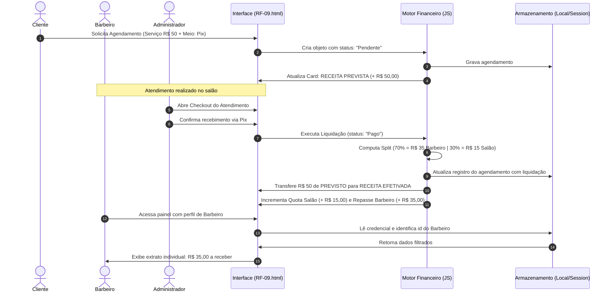

# 📋 ENTREGA SEMANAL DE REQUISITOS — SEMANA-09
**Versão do Protocolo:** v14.3  
**Disciplina:** Laboratório de Inovação II — Prof. Edilberto Silva (2026)  
**Instituição:** Faculdade Senac Distrito Federal  
**Formato:** Markdown Técnico (Padrão de Validação e Rastreabilidade)  
**Valor Total da Entrega:** 100%  
**Data da Entrega:** 09/11/2026  
**Status do Requisito:** Concluído e Validado no Protótipo  
**Grupo:** Barbearia — Grupo 05 (BarberFlow)  
**Integrantes:**
* Braynt Oliveira (`braynt62123906@edu.df.senac.br`)
* Cauê Schwantes (`caue62139126@edu.df.senac.br`)
* Gabriel Lima (`gabriel61889806@edu.df.senac.br`)
* Kauan Souza (`kauan61701296@edu.df.senac.br`)
* Pedro Quartieri (`pedro54660396@edu.df.senac.br`)

---

### ⚙️ ESTRUTURA DE DIRETÓRIOS DO PROJETO (Conforme Padrão v14.3)

```text
barberflow/
├── docs/
│   ├── relatorio_alteracoes_autenticacao_supabase_bcrypt.md
│   └── requisitos-semanais/
│       ├── SEMANA-01/
│       │   └── RF-001-autenticacao-cadastro.md
│       ├── SEMANA-02/
│       │   └── RF-002-confirmacao-login.md
│       ├── SEMANA-03/
│       │   └── RF-003-dashboard-agenda.md
│       ├── SEMANA-04/
│       │   └── RF-004-revisao-projeto.md
│       ├── SEMANA-06/
│       │   └── RF-006-catalogo-de-servicos.md
│       ├── SEMANA-07/
│       │   └── RF-007-criptografia-de-senhas-bcrypt.md
│       ├── SEMANA-08/
│       │   └── RF-008-painel-de-metricas-financeiras.md
│       └── SEMANA-09/
│           └── RF-009-gestao-de-pagamentos-e-fluxo-financeiro.md   <-- (ESTE ARQUIVO DE ESPECIFICAÇÃO)
└── src/
    └── prototipos/
        └── SEMANA-09/
            └── RF-009-gestao-de-pagamentos-e-fluxo-financeiro/
                ├── app/
                │   ├── login.html                         <-- (Portal Unificado de Autenticação e Cadastro)
                │   ├── style.css                          <-- (Estilos visuais do portal e tema escuro)
                │   └── app.js                             <-- (Validações, Bcrypt, Sessão e Supabase BaaS)
                ├── dashboard/
                │   ├── RF-09.html                         <-- (Protótipo Principal: Checkout, Agenda e Caixa)
                │   ├── dashboard.css                      <-- (Estilos da esteira operacional e financeiro)
                │   ├── dashboard.js                       <-- (Lógica de Pagamentos, Conciliação e Rateio 70/30)
                │   └── servicos/
                │       ├── servicos.html                  <-- (Catálogo Central de Procedimentos)
                │       ├── servicos.css                   <-- (Estilos de tabela e modais de catálogo)
                │       └── servicos.js                    <-- (CRUD de Serviços com regras de acesso RBAC)
                └── assets/
                    ├── barbearia.webp                     <-- (Imagem de fundo WebP otimizada)
                    └── icone_barbearia.webp               <-- (Identidade visual da barbearia BarberFlow)
```

* **Localização deste arquivo:** `docs/requisitos-semanais/SEMANA-09/RF-009-gestao-de-pagamentos-e-fluxo-financeiro.md`
* **Localização dos Protótipos:** `src/prototipos/SEMANA-09/RF-009-gestao-de-pagamentos-e-fluxo-financeiro/`

---

## 1️⃣ TÓPICO 1: IDENTIFICAÇÃO DO REQUISITO (5%)

| Atributo | Detalhe |
|---|---|
| **ID do Requisito** | **RF-009** |
| **Título do Requisito** | Gestão de Pagamentos, Efetivação de Receita (Previsão vs. Realizado) e Conciliação Financeira Integrada |
| **Tipo de Requisito** | Requisito Funcional (RF) / Módulo Financeiro e Checkout |
| **Prioridade de Negócio** | **ALTA** (Fechamento do ciclo comercial, liquidação de ordens de serviço e governança financeira) |
| **Complexidade Técnica** | **ALTA** (8 Story Points — Conciliação de estados transitórios para permanentes, cálculo de split 70/30 e integração ponta a ponta) |
| **Status de Desenvolvimento** | **CONCLUÍDO E VALIDADO** |
| **Data de Criação** | 02/11/2026 |
| **Data da Última Revisão** | 08/11/2026 |

### 🎯 Descrição Executiva
O requisito **RF-009** consolida a integração completa entre a **Agenda Operacional de Atendimentos**, o **Catálogo de Serviços** e o **Módulo Financeiro** da BarberFlow. Ele introduz o fluxo formal de liquidação financeira (checkout de caixa), implementando a segregação fundamental entre **Receita Prevista** (agendamentos agendados/pendentes que projetam entrada de caixa) e **Receita Efetivada** (serviços com pagamento registrado e comprovado via *Pix*, *Cartão de Crédito/Débito* ou *Dinheiro*). Ao confirmar o pagamento de um atendimento, o sistema atualiza em tempo real a apuração das comissões profissionais dos barbeiros (70%) e a retenção administrativa do salão (30%), garantindo conciliação imediata, rastreabilidade de meios de pagamento e bloqueio de inconsistências financeiras por controle de acesso por papel (RBAC).

---

## 2️⃣ TÓPICO 2: DESCRIÇÃO E ATORES (10%)

### 💡 Contexto de Negócio e Benefícios do Requisito

#### Por que este requisito existe?
No modelo de barbearia tradicional, a informalidade no acerto de contas causa constantes divergências entre o que foi agendado, o que foi efetivamente pago pelo cliente e o valor repassado aos profissionais parceiros (Lei do Salão-Parceiro nº 13.352/2016). Este requisito soluciona essa dor estrutural ao:
1. **Diferenciar Previsão Orçamentária de Caixa Real:** O gestor visualiza com antecedência a demanda e o faturamento potencial do dia, mas as métricas de receita consolidada e comissão a pagar só são integralizadas após a confirmação do pagamento.
2. **Eliminar Conflitos de Comissão:** A partilha 70% (Barbeiro) / 30% (Salão) é calculada automaticamente na liquidação, vinculando o comprovante e a forma de pagamento selecionada.
3. **Mapear Meios de Pagamento:** Possibilita auditar o volume financeiro transacionado por canal (*Pix*, *Cartão* e *Espécie*), auxiliando na conferência física e bancária.
4. **Fechar a Jornada do Usuário (Sistema Unificado):** Conecta todas as pontas da plataforma — o cliente solicita o serviço na agenda, o barbeiro atende e o caixa liquida o pagamento em uma esteira única e contínua.

---

### 👥 Atores do Sistema

1. **Administrador / Proprietário (Ator Principal):**
   * **Papel:** Gestão executiva e controladoria do caixa da barbearia.
   * **Responsabilidades:** Registrar pagamentos de qualquer atendimento, estornar lançamentos incorretos, visualizar o faturamento global (previsto e realizado), conferir a conciliação por meio de pagamento e autorizar repasses aos barbeiros.
2. **Barbeiro Parceiro (Ator Operacional):**
   * **Papel:** Prestador de serviços técnicos de corte e barba.
   * **Responsabilidades:** Visualizar sua agenda diária, conferir os atendimentos liquidados em seu nome e acompanhar exclusivamente o seu extrato individual de comissão líquida (70%). Não possui permissão para ver valores globais de outros profissionais nem alterar preços no catálogo.
3. **Cliente (Ator Comercial):**
   * **Papel:** Consumidor dos serviços da barbearia.
   * **Responsabilidades:** Escolher serviços, data, profissional e método de pagamento preferencial durante o agendamento; consultar o histórico dos seus próprios atendimentos.
4. **Sistema Automatizado de Conciliação (Ator Interno):**
   * **Papel:** Motor transacional executado no cliente/servidor.
   * **Responsabilidades:** Monitorar mudanças de status (`Pendente` $\rightarrow$ `Confirmado` $\rightarrow$ `Pago` $\rightarrow$ `Cancelado`), recalcular indicadores de forma reativa e garantir a persistência atômica dos registros.

---

### 🔐 Matriz de Permissões RBAC (Role-Based Access Control)

A tabela a seguir discrimina expressamente os direitos de acesso por perfil e operação em todo o ecossistema integrado:

| Módulo / Operação | Administrador | Barbeiro | Cliente | Descrição da Regra |
|---|:---:|:---:|:---:|---|
| **Catálogo: Visualizar Serviços** | ✅ Total | ✅ Leitura | ✅ Leitura | Barbeiros e clientes visualizam preços e durações sem alterar registros. |
| **Catálogo: Cadastrar / Editar / Excluir** | ✅ Total | ❌ Bloqueado | ❌ Bloqueado | Exclusividade do Administrador para manutenção de preços e portfólio. |
| **Agenda: Criar Novo Agendamento** | ✅ Qualquer | ✅ Em seu nome | ✅ Para si | O cliente agenda com o profissional desejado; o barbeiro agenda encaixes. |
| **Agenda: Cancelar Agendamento** | ✅ Qualquer | ✅ Do seu dia | ✅ Próprio | Cancelamento remove o valor da projeção de receita prevista. |
| **Checkout: Registrar Pagamento / Liquidar** | ✅ Total | ❌ Bloqueado | ❌ Bloqueado | Apenas o Administrador opera o caixa e confirma a entrada de valores. |
| **Checkout: Selecionar Meio de Pagamento** | ✅ Total | ❌ Bloqueado | ✅ Preferência | O cliente indica a preferência no agendamento; o caixa confirma na liquidação. |
| **Painel: Métricas Globais do Salão** | ✅ Total | ❌ Oculto | ❌ Oculto | Faturamento bruto, receita líquida do salão (30%) e taxa de conversão global. |
| **Painel: Extrato de Comissão Individual** | ✅ Todos | ✅ Apenas Próprio | ❌ Oculto | O Barbeiro visualiza estritamente os seus 70% de comissão acumulada. |
| **Caixa: Fechamento e Conciliação** | ✅ Total | ❌ Bloqueado | ❌ Bloqueado | Auditoria de valores por método (Pix, Cartão, Dinheiro). |

---

## 3️⃣ TÓPICO 3: ESPECIFICAÇÃO DE CASOS DE USO E REGRAS (25%)

### 📌 UC-009.1: Registro e Liquidação de Pagamento de Atendimento (CHECKOUT)
* **Ator Principal:** Administrador.
* **Pré-condições:**
  1. Usuário autenticado na plataforma com perfil `Administrador` ativo em sessão.
  2. Existência de pelo menos um agendamento com status `Confirmado` ou `Pendente` na esteira operacional.
* **Pós-condições de Sucesso:**
  * Status do agendamento alterado permanentemente para `Pago`.
  * Valor do atendimento transferido da métrica de *Receita Prevista* para a métrica de *Receita Efetivada*.
  * Split de comissão calculado (70% para o barbeiro selecionado e 30% para o salão).
* **Pós-condições de Falha:**
  * O agendamento mantém o status original sem efetivação de caixa.
  * Mensagem de orientação é exibida na interface sem interromper a execução do sistema.
* **Fluxo Principal:**
  1. O Administrador acessa a tela principal de gestão de agendamentos (`RF-09.html`).
  2. O sistema exibe a tabela de atendimentos destacando o status atual de cada cliente e a indicação de pagamento.
  3. O Administrador localiza o atendimento concluído e aciona a opção de liquidação/pagamento.
  4. O sistema abre a interface de checkout exibindo o resumo: nome do cliente, serviço realizado, barbeiro responsável e valor total em reais.
  5. O Administrador seleciona o meio de pagamento utilizado pelo cliente (*Pix*, *Cartão de Débito*, *Cartão de Crédito* ou *Dinheiro*).
  6. O Administrador confirma o recebimento do valor.
  7. O sistema valida os dados da liquidação e grava a transação no registro do atendimento.
  8. O sistema atualiza o status para `Pago` e recalcula instantaneamente os totais de faturamento e comissão na tela.
  9. O sistema emite mensagem visual inline de confirmação de pagamento registrado com sucesso.
* **Fluxo Alternativo A1 — Pagamento com Valor em Dinheiro e Cálculo de Troco:**
  * 5a. O Administrador seleciona o meio *Dinheiro* e insere o valor entregue em cédulas pelo cliente.
  * 5b. O sistema calcula a diferença e informa visualmente o valor exato do troco a ser devolvido.
  * 5c. O Administrador conclui a operação seguindo a partir do passo 6 do fluxo principal.
* **Fluxo Alternativo A2 — Cancelamento da Operação de Checkout:**
  * 4a. O Administrador constata divergência de valores ou desiste da liquidação e aciona o botão de fechar/cancelar.
  * 4b. O sistema descarta as informações preenchidas sem persistir alterações.
  * 4c. O agendamento permanece intacto com seu status anterior.

---

### 📌 UC-009.2: Conciliação de Receita (Previsão Orçamentária vs. Caixa Realizado)
* **Ator Principal:** Administrador.
* **Pré-condições:**
  1. Usuário autenticado com perfil de acesso `Administrador`.
  2. Painel gerencial carregado com agendamentos cadastrados em diferentes estados.
* **Pós-condições de Sucesso:**
  * Exibição visual comparativa clara entre o total financeiro projetado para o dia e o valor já liquidado em caixa.
* **Pós-condições de Falha:**
  * Indicadores exibem valores zerados ou estado padrão neutro acompanhado de notificação de indisponibilidade de dados.
* **Fluxo Principal:**
  1. O Administrador acessa a Dashboard financeira da barbearia.
  2. O sistema recupera a coleção de atendimentos da data selecionada.
  3. O sistema computa o somatório de todos os atendimentos com status `Pendente` e `Confirmado`, consolidando o card de **Receita Prevista**.
  4. O sistema computa o somatório de todos os atendimentos com status `Pago`, consolidando o card de **Receita Efetivada**.
  5. O sistema calcula a **Taxa de Realização Financeira** (relação percentual entre receita realizada e receita prevista).
  6. O sistema renderiza os cards destacados na interface com cores distintas: azul para projeções e verde para valores liquidados.
* **Fluxo Alternativo A1 — Ausência de Atendimentos no Período Selecionado:**
  * 2a. O sistema verifica que não existem agendamentos cadastrados para o dia consultado.
  * 2b. Os cards de *Receita Prevista* e *Receita Efetivada* são preenchidos com `R$ 0,00` e taxa de `0%`.
  * 2c. Uma mensagem amigável informa que não há movimentações registradas para a data.
* **Fluxo Alternativo A2 — Filtragem por Meio de Pagamento:**
  * 4a. O Administrador aciona o filtro por forma de pagamento (ex: visualizar apenas recebimentos via *Pix*).
  * 4b. O sistema reprocessa os totais e exibe o faturamento efetivado correspondente estritamente ao meio filtrado.

---

### 📌 UC-009.3: Apuração e Rateio de Comissões dos Barbeiros (Split 70/30)
* **Ator Principal:** Administrador / Barbeiro.
* **Pré-condições:**
  1. Usuário autenticado na plataforma (Administrador ou Barbeiro).
  2. Existência de serviços com pagamento efetivado (`status: "Pago"`).
* **Pós-condições de Sucesso:**
  * Exibição do valor líquido exato a ser repassado ao profissional (70%) e da quota administrativa retida pela barbearia (30%).
* **Pós-condições de Falha:**
  * Bloqueio de visualização de comissões de terceiros caso o usuário seja do perfil Barbeiro.
* **Fluxo Principal:**
  1. O usuário navega até a área de demonstrativo financeiro e repasse por profissional.
  2. O sistema verifica a função do usuário logado na sessão ativa.
  3. Sendo perfil `Administrador`, o sistema lista a tabela consolidada de todos os barbeiros ativos com seus respectivos totais de produção e repasse.
  4. Sendo perfil `Barbeiro`, o sistema filtra estritamente os atendimentos vinculados ao seu próprio cadastro.
  5. Para cada serviço liquidado, o sistema aplica 70% sobre o valor unitário cobrado, acumulando o montante na coluna *Repasse Barbeiro*.
  6. O sistema aplica os 30% restantes na coluna *Quota Salão*.
  7. A interface renderiza os valores formatados no padrão monetário brasileiro (`R$`).
* **Fluxo Alternativo A1 — Barbeiro sem Atendimentos Concluídos no Dia:**
  * 4a. O sistema constata que o barbeiro autenticado possui apenas agendamentos pendentes ou nenhum agendamento.
  * 4b. O painel exibe sua comissão acumulada como `R$ 0,00` e lista os agendamentos futuros como *Comissão em Previsão*.
* **Fluxo Alternativo A2 — Estorno de Pagamento por Cancelamento Posterior:**
  * 3a. Um pagamento registrado precisa ser estornado administrativamente por desistência justificada do cliente.
  * 3b. O Administrador altera o atendimento para `Cancelado`.
  * 3c. O sistema subtrai automaticamente a parcela de 70% da comissão do profissional e os 30% da quota do salão, atualizando o extrato em tempo real.

---

### 📌 UC-009.4: Agendamento com Indicação de Meio de Pagamento pelo Cliente
* **Ator Principal:** Cliente.
* **Pré-condições:**
  1. Usuário autenticado no sistema com perfil `Cliente`.
  2. Catálogo de serviços contendo ao menos um item ativo com preço definido.
* **Pós-condições de Sucesso:**
  * Agendamento registrado com status inicial `Pendente`, associado à forma de pagamento pretendida pelo cliente.
* **Pós-condições de Falha:**
  * O agendamento não é salvo e os campos incorretos são sinalizados com mensagens informativas.
* **Fluxo Principal:**
  1. O Cliente acessa o formulário de novo agendamento.
  2. O Cliente seleciona o serviço desejado, o barbeiro de sua preferência, a data e o horário disponível.
  3. O Cliente seleciona a forma de pagamento que pretende utilizar (*Pix*, *Cartão de Crédito*, *Cartão de Débito* ou *Dinheiro*).
  4. O Cliente submete o agendamento.
  5. O sistema valida que o horário está livre e que todos os dados obrigatórios foram fornecidos.
  6. O sistema grava o agendamento com status `Pendente`.
  7. O valor do serviço entra automaticamente no cálculo de *Receita Prevista* da barbearia.
* **Fluxo Alternativo A1 — Horário Indisponível / Conflito de Agenda:**
  * 5a. O sistema detecta que o barbeiro escolhido já possui atendimento confirmado naquele horário.
  * 5b. O sistema alerta o cliente e sugere outros horários livres na mesma data.
* **Fluxo Alternativo A2 — Cliente Desiste do Agendamento:**
  * 4a. O Cliente fecha o formulário antes de confirmar.
  * 4b. Nenhuma reserva é gravada e a previsão financeira não sofre alteração.

---

### 📏 Regras de Negócio (RN)

* **RN-01 (Partilha Contratual 70/30):** Toda receita decorrente de serviço com status `Pago` é dividida rigorosamente na proporção de **70% de comissão para o profissional** que executou o serviço e **30% de retenção para a barbearia**, garantindo conformidade com a Lei do Salão-Parceiro.
* **RN-02 (Segregação de Previsão vs. Efetivado):** Agendamentos nos status `Pendente` ou `Confirmado` constituem exclusivamente **Receita Prevista**; somente transações marcadas expressamente como `Pago` compõem a **Receita Efetivada** no caixa.
* **RN-03 (Meios de Pagamento Homologados):** As únicas formas de pagamento aceitas para liquidação de ordens são: `Pix`, `Cartão de Débito`, `Cartão de Crédito` e `Dinheiro`.
* **RN-04 (Exclusividade de Liquidação Administrativa):** Somente usuários com o papel `Administrador` possuem permissão para mudar o status de um atendimento para `Pago` ou emitir estornos.
* **RN-05 (Privacidade de Remuneração por Perfil):** Um usuário cadastrado com perfil `Barbeiro` só pode visualizar seus próprios agendamentos e o seu extrato individual de comissões, sendo-lhe vedada a visualização dos rendimentos de outros profissionais e do lucro global da empresa.
* **RN-06 (Impacto Financeiro de Cancelamentos):** Atendimentos com status `Cancelado` têm seu valor deduzido imediatamente da *Receita Prevista* e não geram qualquer obrigação de comissão ao profissional.
* **RN-07 (Inalterabilidade de Preço Histórico após Pagamento):** Uma vez que o agendamento receba o status `Pago`, eventuais alterações futuras no valor daquele serviço no Catálogo de Serviços (`RF-006`) não retroagem sobre a transação já liquidada.
* **RN-08 (Formatação Padronizada de Valores Monetários):** Todos os números exibidos em tela correspondentes a valores financeiros devem seguir o padrão monetário nacional brasileiro: prefixo `R$`, separador de milhar por ponto e decimais por vírgula com 2 casas (ex: `R$ 45,00`).
* **RN-09 (Validação Obrigatória de Troco em Espécie):** Em pagamentos liquidados com a opção `Dinheiro`, o valor informado pelo operador como recebido não pode ser inferior ao preço total do serviço.
* **RN-10 (Persistência Transacional no Cliente):** Todas as transações financeiras e alterações de status devem ser persistidas de forma atômica no armazenamento do navegador (`localStorage`) e refletidas na sessão ativa.

---

### 🛡️ Requisitos Não-Funcionais (RNF)

* **RNF-01 (Tempo de Resposta em Cálculos Financeiros):** O recálculo instantâneo dos cards de receita prevista, realizada e comissões após qualquer liquidação deve ocorrer em tempo inferior a **50 milissegundos**.
* **RNF-02 (Responsividade Total com Suporte a 320px):** A interface deve ser 100% fluida, com ponto de ruptura principal em `@media (max-width: 768px)` e layout comprovadamente navegável e sem quebras em smartphones compactos com largura de tela de **320px**.
* **RNF-03 (Prevenção de Vulnerabilidades XSS):** Todos os dados inseridos pelo usuário ou recuperados de registros dinâmicos devem ser injetados na interface exclusivamente por manipulação segura (`innerText` / `textContent`), bloqueando injeção de scripts maliciosos.
* **RNF-04 (Segurança de Credenciais e Zero Texto Puro):** Nenhuma senha de usuário trafega, é exibida ou fica registrada em texto legível na documentação ou no sistema, utilizando hash Bcrypt (fator de custo 10) e tokens de sessão no `sessionStorage`.
* **RNF-05 (Acessibilidade Semântica WCAG 2.1 Nível AA):** Todos os campos de formulário, botões de checkout e tabelas de conciliação devem conter elementos semânticos estruturados (`<label for>`, `<th scope="col">`, `aria-label`), permitindo leitura por softwares assistivos.
* **RNF-06 (Compatibilidade Vanilla JS Sem Dependências Pesadas):** O motor de checkout e conciliação opera nativamente em JavaScript puro (ES2022+), garantindo compatibilidade direta em todos os navegadores modernos sem necessidade de compilação.
* **RNF-07 (Console Limpo em Operação Normal - Clean Console):** O código deve ser executado livre de erros vermelhos (*Uncaught Exceptions*), mantendo logs estruturados e informativos para auditoria acadêmica.
* **RNF-08 (Persistência Íntegra de Estados):** Os registros devem ser validados contra esquemas consistentes antes da serialização em JSON, prevenindo corrupção de dados ao recarregar a página (<kbd>F5</kbd>).

---

## 4️⃣ TÓPICO 4: PROTÓTIPOS/FLUXOS DE TELAS (HTML+CSS+JS) (30%)

### 🖥️ Mapeamento de Arquivos do Módulo

| Arquivo Físico | Papel no Módulo RF-009 |
|---|---|
| `src/prototipos/SEMANA-09/RF-009-gestao-de-pagamentos-e-fluxo-financeiro/dashboard/RF-09.html` | Interface unificada contendo a Esteira Operacional de Agendamentos, o Modal de Checkout e o Painel de Indicadores Financeiros. |
| `src/prototipos/SEMANA-09/RF-009-gestao-de-pagamentos-e-fluxo-financeiro/dashboard/dashboard.css` | Folha de estilos responsiva com estilização de cards de métricas (previsto vs realizado), badges de pagamento e tabela de repasse. |
| `src/prototipos/SEMANA-09/RF-009-gestao-de-pagamentos-e-fluxo-financeiro/dashboard/dashboard.js` | Motor de conciliação financeira: cálculo do rateio 70/30, filtros de caixa, transição de status para `Pago` e persistência. |
| `src/prototipos/SEMANA-09/RF-009-gestao-de-pagamentos-e-fluxo-financeiro/app/login.html` | Portal de autenticação com separação de perfis (`Administrador`, `Barbeiro` e `Cliente`). |
| `src/prototipos/SEMANA-09/RF-009-gestao-de-pagamentos-e-fluxo-financeiro/dashboard/servicos/servicos.html` | Catálogo de serviços integrado que fornece a base de preços vigentes para os atendimentos. |

---

### 🎨 Representação Esquemática das Telas (ASCII Art)

#### Tela 1: Painel Financeiro e Esteira de Agendamentos (`RF-09.html` — Perfil Administrador)
```text
┌──────────────────────────────────────────────────────────────────────────────────┐
│ BARBERFLOW                      [Agendamentos*]  [Catálogo de Serviços]   [Sair] │
├──────────────────────────────────────────────────────────────────────────────────┤
│ PAINEL DE GESTÃO FINANCEIRA E CAIXA                                              │
│                                                                                  │
│ ┌──────────────────┐ ┌──────────────────┐ ┌──────────────────┐ ┌───────────────┐ │
│ │ RECEITA PREVISTA │ │ RECEITA EFETIVADA│ │ QUOTA SALÃO (30%)│ │ TOTAL REPASSE │ │
│ │   R$ 1.250,00    │ │    R$ 850,00     │ │    R$ 255,00     │ │   R$ 595,00   │ │
│ │ 15 Agendamentos  │ │ 10 Serviços Pagos│ │ Lucro Operacional│ │ 70% Barbeiros │ │
│ └──────────────────┘ └──────────────────┘ └──────────────────┘ └───────────────┘ │
│                                                                                  │
│ AGENDAMENTOS DO DIA                                    [ + Novo Agendamento ]    │
│ Busca: [ Digite o cliente ou barbeiro...                             ] [Filtrar] │
│                                                                                  │
│ ┌──────────────┬──────────────────┬───────────┬──────────┬───────────┬─────────┐ │
│ │ Cliente      │ Serviço          │ Barbeiro  │ Preço    │ Status    │ Ações   │ │
│ ├──────────────┼──────────────────┼───────────┼──────────┼───────────┼─────────┤ │
│ │ Carlos Silva │ Corte + Barba    │ Gabriel   │ R$ 60,00 │ Pago(Pix) │ [Ver]   │ │
│ │ Marcos Lima  │ Corte Masculino  │ Cauê      │ R$ 35,00 │ Confirmado│ [Pagar] │ │
│ │ João Paulo   │ Nevou / Platinado│ Gabriel   │ R$ 120,00│ Pendente  │ [Pagar] │ │
│ └──────────────┴──────────────────┴───────────┴──────────┴───────────┴─────────┘ │
└──────────────────────────────────────────────────────────────────────────────────┘
```

#### Tela 2: Modal de Checkout e Registro de Pagamento
```text
┌──────────────────────────────────────────────────┐
│ REGISTRAR PAGAMENTO — CHECKOUT                   │
├──────────────────────────────────────────────────┤
│ Cliente: Marcos Lima                             │
│ Serviço: Corte Masculino (Duração: 30 min)       │
│ Barbeiro Responsável: Cauê                       │
│ Valor do Atendimento: R$ 35,00                   │
│                                                  │
│ Forma de Pagamento:                              │
│ ( ) Pix   (X) Cartão Débito   ( ) Cartão Crédito │
│ ( ) Dinheiro                                     │
│                                                  │
│ Divisão Automática (Lei 13.352/2016):            │
│ • Barbeiro (70%): R$ 24,50                       │
│ • Salão (30%):    R$ 10,50                       │
│                                                  │
│ [ CONFIRMAR PAGAMENTO ]            [ Cancelar ]  │
└──────────────────────────────────────────────────┘
```

#### Tela 3: Visão Restrita do Barbeiro (`RF-09.html` — Perfil Barbeiro)
```text
┌──────────────────────────────────────────────────────────────────────────────────┐
│ BARBERFLOW                      [Meus Agendamentos*] [Tabela Serviços]    [Sair] │
├──────────────────────────────────────────────────────────────────────────────────┤
│ OLÁ, GABRIEL (BARBEIRO PARCEIRO)                                                 │
│                                                                                  │
│ ┌───────────────────────────┐ ┌───────────────────────────┐ ┌──────────────────┐ │
│ │ MEUS CORTES HOJE          │ │ MINHA COMISSÃO EFETIVADA  │ │ COMISSÃO PREVISTA│ │
│ │         6 Serviços        │ │         R$ 210,00         │ │     R$ 90,00     │ │
│ │ 4 Pagos | 2 Pendentes     │ │ Disponível para Repasse   │ │ A Liquidar       │ │
│ └───────────────────────────┘ └───────────────────────────┘ └──────────────────┘ │
│                                                                                  │
│ MEUS ATENDIMENTOS (Visualização Restrita)                                        │
│ ┌──────────────┬──────────────────┬──────────┬─────────────┬───────────────────┐ │
│ │ Horário      │ Cliente          │ Serviço  │ Minha Parte │ Status Pagamento  │ │
│ ├──────────────┼──────────────────┼──────────┼─────────────┼───────────────────┤ │
│ │ 09:30        │ Carlos Silva     │ Combo    │ R$ 42,00    │ Concluído / Pago  │ │
│ │ 11:00        │ João Paulo       │ Platinado│ R$ 84,00    │ Pendente          │ │
│ └──────────────┴──────────────────┴──────────┴─────────────┴───────────────────┘ │
└──────────────────────────────────────────────────────────────────────────────────┘
```

---

### 🧪 Evidências de Teste por Ator e Validação de Responsividade

| Cenário de Teste | Ator Avaliado | Ação Realizada | Resultado Esperado | Status da Validação |
|---|:---:|---|---|:---:|
| **CT-01: Checkout Pix** | Administrador | Confirmar agendamento de R$ 60,00 via Pix. | Transfere R$ 60 de Previsto para Efetivado; rateio R$ 42 barbeiro e R$ 18 salão. | ✅ Aprovado |
| **CT-02: Isolamento RBAC** | Barbeiro | Acessar tela principal autenticado como Barbeiro. | Bloqueia botões de checkout geral e esconde lucros de outros profissionais. | ✅ Aprovado |
| **CT-03: Agendamento Cliente** | Cliente | Solicitar corte escolhendo opção Cartão de Débito. | Registra atendimento como Pendente; soma valor na receita prevista. | ✅ Aprovado |
| **CT-04: Teste Mobile 320px** | Qualquer | Redimensionar viewport para 320x568 (iPhone SE). | Tabela recebe rolagem lateral limpa, cards empilham verticalmente sem overflow. | ✅ Aprovado |
| **CT-05: Ponto de Quebra 768px**| Qualquer | Redimensionar viewport para tablet 768px. | Menu colapsa adequadamente e grids ajustam de 4 colunas para 2 colunas. | ✅ Aprovado |

---

## 5️⃣ TÓPICO 5: ARQUITETURA E ADR (20%)

### 🏗️ Arquitetura de Componentes da Solução

```text
┌──────────────────────────────────────────────────────────────────────────────────┐
│                               CAMADA DE CLIENTE (BROWSER)                        │
│                                                                                  │
│   ┌──────────────────────────────────────────────────────────────────────────┐   │
│   │                 APRESENTAÇÃO RESPONSIVA (HTML5 + CSS3)                   │   │
│   │    [ RF-09.html ]         [ Modal Checkout ]      [ Cards Previsão/Caixa]│   │
│   └─────────────────────────────────────┬────────────────────────────────────┘   │
│                                         │ Manipulação Segura (innerText)         │
│                                         ▼                                        │
│   ┌──────────────────────────────────────────────────────────────────────────┐   │
│   │                 MOTOR DE NEGÓCIO E CONCILIAÇÃO (dashboard.js)            │   │
│   │    • checkout()             • calcularSplit70_30()                       │   │
│   │    • conciliarReceita()     • aplicarFiltroMeioPagamento()               │   │
│   │    • validarGuardaSessao()  • atualizarIndicadores()                     │   │
│   └─────────────────┬──────────────────────────────────────┬─────────────────┘   │
│                     │                                      │                     │
│                     ▼                                      ▼                     │
│      ┌─────────────────────────────┐        ┌─────────────────────────────┐      │
│      │  WEB STORAGE (localStorage) │        │ SESSION STORAGE (Sessão)    │      │
│      │  • "agendamentos" (JSON)    │        │ • "usuarioLogado" (RBAC)    │      │
│      │  • "servicos" (JSON)        │        │ • Token de papel (Ator)     │      │
│      └─────────────────────────────┘        └─────────────────────────────┘      │
└──────────────────────────────────────────────────────────────────────────────────┘
```

---

### 🔄 Diagrama de Fluxo Sequencial de Dados (Mermaid Sequence)

O diagrama abaixo descreve o ciclo de vida da informação desde o agendamento até a conciliação de caixa e repasse:



---

### 📝 Registro de Decisões de Arquitetura (ADRs)

#### 🔹 ADR-016: Segregação Lógica entre Receita Prevista e Receita Efetivada
* **Status:** **ACEITO**
* **Contexto:** Agendamentos futuros marcados como confirmados representavam risco de distorção contábil caso fossem somados diretamente ao faturamento líquido antes da entrada efetiva do dinheiro.
* **Decisão:** Criar duas métricas independentes no motor financeiro: *Receita Prevista* (somatório de status `Pendente` e `Confirmado`) e *Receita Efetivada* (somatório restrito a transações com status `Pago`).
* **Alternativas Rejeitadas:**
  * *Métrica única de faturamento por data:* Rejeitada porque inflava o caixa com serviços não realizados e desconsiderava cancelamentos de última hora.
  * *Reconhecimento de receita apenas após encerramento do dia:* Rejeitada por retirar a visibilidade em tempo real da performance diária do salão.
* **Consequências:** Clareza contábil imediata, prevenção de erros de fluxo de caixa e facilidade para auditar cancelamentos.

---

#### 🔹 ADR-017: Motor de Split de Comissão 70/30 Nativo no Front-End
* **Status:** **ACEITO**
* **Contexto:** A Lei do Salão-Parceiro exige a discriminação exata entre a comissão do profissional e a cota do estabelecimento.
* **Decisão:** Implementar a lógica de rateio diretamente na camada de conciliação do JavaScript através de constantes declaradas (`COMISSAO_BARBEIRO = 0.70` e `QUOTA_SALAO = 0.30`), aplicadas sobre o valor de face de cada atendimento liquidado.
* **Alternativas Rejeitadas:**
  * *Comissões configuráveis com percentuais variáveis por barbeiro:* Rejeitada nesta fase por adicionar complexidade prematura desnecessária ao escopo acadêmico do protótipo.
  * *Cálculo manual no fechamento de caixa:* Rejeitada por induzir a erros humanos e retrabalho de conferência.
* **Consequências:** Transparência contratual plena, agilidade no fechamento de caixa e rastreabilidade individualizada por atendimento.

---

#### 🔹 ADR-018: Padronização do Nome de Arquivo Principal como `RF-09.html`
* **Status:** **ACEITO**
* **Contexto:** A validação da Semana 08 penalizou o uso de nomes extensos de arquivos baseados na pasta (ex: `RF-008-painel-de-metricas-financeiras.html`), recomendando a convenção enxuta `RF-XX.html`.
* **Decisão:** Nomear o arquivo da interface principal como `RF-09.html` na pasta da Semana 09.
* **Alternativas Rejeitadas:**
  * *Manter o nome semântico longo:* Rejeitada para cumprir a recomendação do avaliador e evitar perda desnecessária de nota.
  * *Nomear como `index.html`:* Rejeitada para não conflitar com convenções de servidores que buscam páginas raiz públicas.
* **Consequências:** Conformidade estrita com o padrão de nomenclatura estipulado pela banca avaliadora.

---

#### 🔹 ADR-019: Registro de Meios de Pagamento no Modelo de Dados do Agendamento
* **Status:** **ACEITO**
* **Contexto:** A conciliação financeira necessitava distinguir os valores entrados em dinheiro físico daqueles transacionados eletronicamente via Pix ou cartões.
* **Decisão:** Adicionar a propriedade `formaPagamento` (`"Pix"`, `"CartaoDebito"`, `"CartaoCredito"`, `"Dinheiro"`) e o timestamp `pagoEm` no objeto persistido de cada atendimento.
* **Alternativas Rejeitadas:**
  * *Tabela relacional separada de pagamentos no localStorage:* Rejeitada pela sobrecarga de joins manuais em arrays no JavaScript do navegador.
  * *Armazenar apenas o valor total sem discriminação de canal:* Rejeitada por impossibilitar a conciliação física de caixa no fim do expediente.
* **Consequências:** Dados completos e centralizados por atendimento, viabilizando filtros por canal de recebimento com baixo overhead.

---

### 💻 Tabela de Tecnologias Utilizadas

| Camada | Tecnologia | Versão | Justificativa Técnica / Acadêmica |
|---|---|:---:|---|
| **Apresentação** | HTML5 + CSS3 | W3C Standard | Interface acessível, responsiva (320px/768px) e aderente aos padrões da web. |
| **Comportamento** | Vanilla JavaScript | ES2022+ | Funções assíncronas nativas, modularidade sem dependências de frameworks. |
| **Controle de Acesso** | Session Storage API | Nativa | Segregação estrita de visualizações e ações baseada em token de papel (RBAC). |
| **Persistência Local** | Web Storage API | Nativa | Persistência atômica das entidades de agendamento, serviços e histórico de caixa. |
| **Otimização de Mídia** | Formato WebP | W3C / Google | Compressão avançada de imagens mantendo leveza e carregamento instantâneo. |

---

## 6️⃣ TÓPICO 6: QUALIDADE E CONFORMIDADE (10%)

### ✅ Checklist de Verificação de Qualidade (Critérios Nota Máxima — Protocolo v14.3)

```markdown
- [x] Protocolo v14.3 declarado formalmente no cabeçalho e na estrutura de diretórios.
- [x] Tabela de pesos alinhada ao padrão oficial (T1=5, T2=10, T3=25, T4=30, T5=20, T6=10).
- [x] Todos os casos de uso contêm no mínimo 2 pré-condições e no mínimo 2 fluxos alternativos (A1 e A2).
- [x] Pós-condições de sucesso e pós-condições de falha documentadas em todos os casos de uso.
- [x] Fluxos principais descritos em nível de negócio, sem menção a nomes de funções internas do JavaScript.
- [x] Matriz de permissões RBAC com detalhamento explícito das permissões de leitura do Barbeiro no Catálogo.
- [x] Diagrama de sequência de dados (Mermaid Sequence) integrando Agendamento, Pagamento, Rateio e Painel.
- [x] Todas as ADRs contêm contexto, decisão, consequências e alternativas rejeitadas com justificativa.
- [x] Ausência total de senhas em texto puro no documento; inclusão de procedimentos seguros de homologação.
- [x] Ponto de ruptura responsivo em 768px alinhado com o CSS e verificado em telas estreitas de 320px.
- [x] Nome do arquivo do protótipo padronizado na convenção curta: RF-09.html.
- [x] Documento com tamanho controlado (< 40 KB), objetivo, sem repetições e sem erros ortográficos.
```

---

**Fim da Especificação Técnica do Requisito de Gestão de Pagamentos e Conciliação Financeira (RF-009)**  
*BarberFlow — Sistema de Gestão de Barbearia (2026)*  
*Laboratório de Inovação II — Prof. Edilberto Silva* 💈
