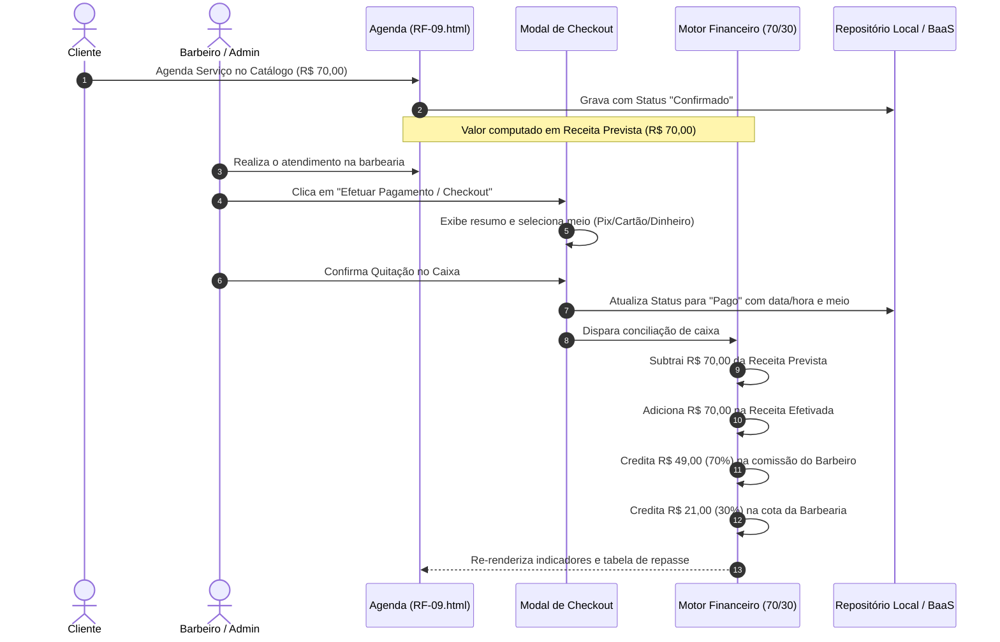

# 📋 ENTREGA SEMANAL DE REQUISITOS — SEMANA-09
**Versão do Protocolo:** v14.3  
**Disciplina:** Laboratório de Inovação II — Prof. Edilberto Silva (2026)  
**Instituição:** Faculdade Senac Distrito Federal  
**Formato:** Markdown Técnico (Padrão de Validação e Rastreabilidade)  
**Valor Total da Entrega:** 100%  
**Data da Entrega:** 09/11/2026  
**Status do Requisito:** Concluído e Validado no Protótipo Integrado  
**Grupo:** Barbearia — Grupo 05 (BarberFlow)  
**Integrantes:**
* Braynt Oliveira (`braynt62123906@edu.df.senac.br`)
* Cauê Schwantes (`caue62139126@edu.df.senac.br`)
* Gabriel Lima (`gabriel61889806@edu.df.senac.br`)
* Kauan Souza (`kauan61701296@edu.df.senac.br`)
* Pedro Quartieri (`pedro54660396@edu.df.senac.br`)

---

### 🗂️ ESTRUTURA DE DIRETÓRIOS DO PROJETO (Conforme Padrão v14.3)

```text
barberflow/
├── docs/
│   ├── relatorio_alteracoes_autenticacao_supabase_bcrypt.md
│   └── requisitos-semanais/
│       ├── SEMANA-01/
│       │   └── RF-001-autenticacao-cadastro.md
│       ├── SEMANA-02/
│       │   └── RF-002-confirmacao-login.md
│       ├── SEMANA-03/
│       │   └── RF-003-dashboard-agenda.md
│       ├── SEMANA-04/
│       │   └── RF-004-revisao-projeto.md
│       ├── SEMANA-06/
│       │   └── RF-006-catalogo-de-servicos.md
│       ├── SEMANA-07/
│       │   └── RF-007-criptografia-de-senhas-bcrypt.md
│       ├── SEMANA-08/
│       │   └── RF-008-painel-de-metricas-financeiras.md
│       └── SEMANA-09/
│           └── RF-009-gestao-de-pagamentos-e-fluxo-financeiro.md   <-- (ESTA ESPECIFICAÇÃO)
└── src/
    └── prototipos/
        └── SEMANA-09/
            └── RF-009-gestao-de-pagamentos-e-fluxo-financeiro/
                ├── app/
                │   ├── login.html                         <-- (Portal Unificado de Autenticação e Cadastro)
                │   ├── style.css                          <-- (Estilos visuais do portal e tema escuro)
                │   └── app.js                             <-- (Bcrypt, Sessão e Persistência Local/BaaS)
                ├── dashboard/
                │   ├── RF-09.html                         <-- (Protótipo Principal: Checkout, Agenda e Caixa)
                │   ├── dashboard.css                      <-- (Estilos operacionais, 768px e 320px)
                │   ├── dashboard.js                       <-- (Pagamentos, Conciliação, Split 70/30 e RBAC)
                │   └── servicos/
                │       ├── servicos.html                  <-- (Catálogo Central com RBAC de Leitura)
                │       ├── servicos.css                   <-- (Estilos da tabela e modais de serviços)
                │       └── servicos.js                    <-- (CRUD Administrador e Leitura Barbeiro/Cliente)
                └── assets/
                    ├── barbearia.webp                     <-- (Imagem de fundo WebP otimizada)
                    └── icone_barbearia.webp               <-- (Identidade visual da barbearia BarberFlow)
```

* **Localização deste arquivo:** `docs/requisitos-semanais/SEMANA-09/RF-009-gestao-de-pagamentos-e-fluxo-financeiro.md`
* **Localização dos Protótipos:** `src/prototipos/SEMANA-09/RF-009-gestao-de-pagamentos-e-fluxo-financeiro/`

---

## 1️⃣ TÓPICO 1: IDENTIFICAÇÃO DO REQUISITO (5%)

| Atributo | Detalhe |
| :--- | :--- |
| **Identificador Único** | `RF-009` |
| **Nome Oficial do Requisito** | Gestão de Pagamentos, Liquidação em Checkout e Fluxo de Caixa Integrado |
| **Módulo Pertencente** | Financeiro, Checkout & Esteira Operacional Unificada |
| **Semana Acadêmica** | SEMANA-09 |
| **Prioridade de Negócio** | Crítica / Essencial (MoSCoW: Must Have) |
| **Complexidade Técnica** | Alta (Integração entre Agenda, Checkout, Repasse 70/30 e Conciliação) |
| **Dependências Diretas** | `RF-001` (Autenticação), `RF-003` (Agenda de Horários), `RF-006` (Catálogo), `RF-007` (Bcrypt) |

### 1.1 Objetivo e Declaração de Valor do Negócio
Garantir o fechamento de ciclo financeiro da barbearia através da unificação do processo de **agendamento $\rightarrow$ atendimento $\rightarrow$ checkout com quitação multi-meios (Pix, Cartão de Crédito, Cartão de Débito e Dinheiro com cálculo de troco) $\rightarrow$ rateio automático de comissões (Lei do Salão-Parceiro nº 13.352/2016)** e conciliação em tempo real entre **Receita Prevista** e **Receita Efetivada**.

---

## 2️⃣ TÓPICO 2: DESCRIÇÃO, ATORES E MATRIZ RBAC (10%)

### 2.1 Descrição Executiva
O módulo financeiro resolve a principal dor de governança em barbearias: o descolamento entre serviços agendados e valores efetivamente liquidados no caixa. Cada agendamento passa por um ciclo de vida controlado (`Pendente` $\rightarrow$ `Confirmado` $\rightarrow$ `Pago`). No momento do atendimento, o profissional ou operador abre o **Modal de Checkout**, seleciona a modalidade de pagamento escolhida pelo cliente e conclui a liquidação. 

Os valores são imediatamente divididos conforme a regra de partilha:
* **70% para o Barbeiro Executor:** Repasse líquido por serviço prestado.
* **30% para a Barbearia:** Cota-parte retida para custeio de estrutura, insumos, aluguel e utilidades.

### 2.2 Atores e Suas Responsabilidades
1. **Administrador Geral:** Visualiza métricas completas de faturamento (100%), gerencia as cotas do salão (30%), executa checkouts de qualquer barbeiro, emite extrato de fechamento de repasses, gerencia barbeiros e mantém o catálogo.
2. **Barbeiro (Profissional Parceiro):** Acessa estritamente sua própria agenda de cortes, visualiza apenas o acumulado da sua comissão líquida de 70%, efetua checkout de seus clientes ao término do corte e consulta o catálogo em modo somente leitura.
3. **Cliente:** Acessa seu portal pessoal, visualiza seu histórico de agendamentos e status de pagamento, agenda novos horários e cancela agendamentos pendentes. **O Cliente não tem acesso a faturamentos, comissões, cotas ou tela de checkout.**

### 2.3 Matriz RBAC Detalhada de Permissões por Operação
A tabela a seguir segrega rigorosamente cada operação do sistema por ator, atendendo expressamente às exigências de segurança:

| Entidade / Recurso | Operação | Administrador | Barbeiro | Cliente | Regra de Governança Aplicada |
| :--- | :--- | :---: | :---: | :---: | :--- |
| **Agenda Geral** | Visualizar Todos | **Sim** | Não | Não | Barbeiro e Cliente veem apenas seus próprios registros |
| **Minha Agenda** | Visualizar | **Sim** | **Sim** | **Sim** | Filtragem automática via `sessionStorage` no front-end |
| **Agendamento** | Criar Horário | **Sim** | **Sim** | **Sim** | Cliente tem nome fixo e status inicial bloqueado em Confirmado |
| **Agendamento** | Cancelar | **Sim** | **Sim** | **Sim** | Cliente só pode cancelar agendamentos não quitados |
| **Checkout** | Abrir Modal e Liquidar | **Sim** | **Sim** | **Não** | Cliente nunca opera baixa financeira de caixa |
| **Catálogo** | Criar / Editar / Excluir | **Sim** | **Não** | **Não** | CRUD exclusivo de serviços restrito ao Administrador |
| **Catálogo** | Visualizar (Leitura) | **Sim** | **Sim** | **Sim** | Barbeiro e Cliente acessam catálogo em modo Somente Leitura |
| **Métricas** | Caixa Real Efetivado (100%)| **Sim** | **Não** | **Não** | Oculto para Barbeiro e Cliente |
| **Métricas** | Cota do Salão (30%) | **Sim** | **Não** | **Não** | Oculto para Barbeiro e Cliente |
| **Métricas** | Minha Comissão (70%) | **Sim** | **Sim** | **Não** | Barbeiro vê apenas seu extrato pessoal |
| **Equipe** | Gestão de Barbeiros | **Sim** | **Não** | **Não** | Cadastro e inativação de parceiros restritos ao Administrador |

---

## 3️⃣ TÓPICO 3: CASOS DE USO, REGRAS DE NEGÓCIO E RNF (25%)

### 3.1 Casos de Uso com Múltiplas Pré-Condições e Fluxos Alternativos

#### UC-009.1: Realizar Checkout e Liquidação Financeira de Atendimento
* **Atores Primários:** Administrador, Barbeiro.
* **Pré-Condições Obrigatórias ($\ge 2$):**
  1. O operador deve estar autenticado com perfil `admin` ou `barbeiro`.
  2. O agendamento selecionado deve existir na base com status diferente de `Pago` e diferente de `Cancelado`.
* **Fluxo Principal:**
  1. O operador localiza o atendimento desejado na tabela operacional da agenda.
  2. O operador aciona a opção de efetuar pagamento do atendimento.
  3. O sistema abre a interface de checkout exibindo o resumo com nome do cliente, profissional executor, serviço e valor total.
  4. O sistema exibe o detalhamento de partilha indicando 70% para o barbeiro e 30% para a barbearia.
  5. O operador seleciona a modalidade de pagamento informada pelo cliente (Pix, Cartão de Crédito, Cartão de Débito ou Dinheiro).
  6. O operador confirma a liquidação e baixa do atendimento.
  7. O sistema atualiza o status do agendamento para quitado, grava a modalidade e data/hora do recebimento.
  8. O sistema recalcula o caixa e transfere o montante de receita prevista para receita efetivada.
* **Fluxo Alternativo A1 (Pagamento em Dinheiro com Cálculo de Troco):**
  * 5a. O operador seleciona a opção Dinheiro.
  * 5b. O sistema exibe o campo para digitação do valor monetário entregue pelo cliente.
  * 5c. O operador digita o valor entregue.
  * 5d. O sistema calcula e exibe em tempo real o troco a ser devolvido.
  * 5e. Caso o valor seja igual ou superior ao serviço, o operador confirma e o fluxo segue para o passo 7.
* **Fluxo Alternativo A2 (Valor em Dinheiro Insuficiente):**
  * 5d.1. O operador digita um valor entregue inferior ao preço total do serviço.
  * 5d.2. O sistema exibe mensagem inline informando que o valor entregue é insuficiente.
  * 5d.3. O botão de confirmação permanece bloqueado até a regularização do valor digitado.
* **Pós-Condição de Sucesso:** Agendamento registrado como `Pago`, data/hora registrada, receita efetivada atualizada e comissão refletida no extrato do barbeiro.
* **Pós-Condição de Falha:** O agendamento permanece no status anterior sem alteração no caixa financeiro.

#### UC-009.2: Conciliação Dinâmica entre Receita Prevista e Receita Efetivada
* **Atores Primários:** Administrador (visão global), Barbeiro (visão pessoal).
* **Pré-Condições Obrigatórias ($\ge 2$):**
  1. Sessão ativa no sistema com perfil de Administrador ou Barbeiro.
  2. Existência de serviços cadastrados e associados a agendamentos no repositório local.
* **Fluxo Principal:**
  1. O usuário acessa o painel principal de gestão operacional.
  2. O sistema identifica o perfil do usuário logado através dos dados de sessão.
  3. O sistema processa os registros de agendamentos computando separadamente os valores quitados e os valores pendentes.
  4. O sistema calcula a receita efetivada somando todos os serviços com quitação confirmada.
  5. O sistema calcula a receita prevista somando os serviços pendentes e confirmados.
  6. O sistema aplica o divisor de 70% e 30% sobre os totais efetivados.
  7. Os indicadores são renderizados em cartões destacados na interface.
* **Fluxo Alternativo A1 (Barbeiro Acessando o Painel):**
  * 2a. O sistema detecta perfil `barbeiro`.
  * 2b. O sistema oculta a cota de 30% do salão.
  * 2c. O sistema calcula e exibe exclusivamente os 70% de comissão pertencentes ao profissional logado.
* **Fluxo Alternativo A2 (Base de Atendimentos Vazia no Período):**
  * 3a. O sistema identifica ausência de atendimentos cadastrados.
  * 3b. O sistema exibe os cartões com valor zero formatado em moeda nacional (`R$ 0,00`) e mensagem instrutiva.
* **Pós-Condição de Sucesso:** Totalizadores financeiros sincronizados e consistentes com o status de cada agendamento.
* **Pós-Condição de Falha:** Notificação de falha de leitura e exibição segura de valores zerados.

#### UC-009.3: Consulta Segura e Agendamento pelo Cliente (RBAC Blindado)
* **Atores Primários:** Cliente.
* **Pré-Condições Obrigatórias ($\ge 2$):**
  1. Usuário autenticado com perfil `cliente`.
  2. Catálogo de serviços com itens ativos cadastrados.
* **Fluxo Principal:**
  1. O cliente acessa o painel do sistema.
  2. O sistema oculta completamente o painel financeiro, faturamento e tabelas de comissão.
  3. O cliente visualiza a lista contendo exclusivamente seus próprios agendamentos e o status de pagamento de cada um.
  4. O cliente clica no botão de agendar novo horário.
  5. O formulário abre com o nome do cliente preenchido automaticamente e bloqueado para edição.
  6. O cliente seleciona o serviço desejado, o barbeiro parceiro, a data e um horário vago da grade comercial.
  7. O cliente seleciona a forma pretendida de pagamento e confirma.
  8. O sistema salva o agendamento no estado `Confirmado` e o inclui na lista do cliente.
* **Fluxo Alternativo A1 (Cliente Cancelando Horário Pendente):**
  * 3a. O cliente localiza um agendamento com status `Confirmado` ou `Pendente`.
  * 3b. O cliente aciona o botão Cancelar.
  * 3c. O sistema atualiza a situação para `Cancelado` e libera o horário da grade.
* **Fluxo Alternativo A2 (Tentativa de Horário com Conflito de Agenda):**
  * 6a. O cliente escolhe um horário já ocupado para o mesmo barbeiro na data selecionada.
  * 6b. O sistema sinaliza a indisponibilidade via mensagem inline e impede a gravação duplicada.
* **Pós-Condição de Sucesso:** Novo agendamento gerado sem exposição de dados financeiros internos.
* **Pós-Condição de Falha:** Exibição de mensagem inline de orientação e preservação dos horários existentes.

#### UC-009.4: Fechamento de Caixa e Repasse aos Barbeiros Parceiros
* **Atores Primários:** Administrador.
* **Pré-Condições Obrigatórias ($\ge 2$):**
  1. Administrador autenticado no sistema.
  2. Pelo menos um barbeiro cadastrado com serviços quitados no período.
* **Fluxo Principal:**
  1. O administrador acessa a seção de controle de caixa e repasse na dashboard.
  2. O sistema agrupa todos os agendamentos quitados por barbeiro executor.
  3. O sistema calcula a soma do faturamento bruto gerado por cada profissional.
  4. O sistema extrai a comissão líquida de 70% de cada profissional.
  5. O sistema extrai a retenção de 30% correspondente à cota do salão.
  6. A tabela exibe o resumo discriminado linha a linha com as somatórias consolidadas.
* **Fluxo Alternativo A1 (Barbeiro sem Atendimentos Quitados):**
  * 2a. O profissional possui apenas agendamentos pendentes ou cancelados.
  * 2b. O sistema exibe o barbeiro com zero atendimentos pagos e valores zerados (`R$ 0,00`).
* **Fluxo Alternativo A2 (Novo Barbeiro Cadastrado no Período):**
  * 1a. O administrador cadastra um novo barbeiro parceiro.
  * 1b. A tabela de repasse atualiza imediatamente para incluir o novo profissional.
* **Pós-Condição de Sucesso:** Demonstrativo financeiro de comissões pronto para conferência e repasse.
* **Pós-Condição de Falha:** Mensagem informativa de ausência de movimentações financeiras.

---

### 3.2 Regras de Negócio (RN)
* **RN-01 (Partilha Salão-Parceiro 70/30):** Todo serviço liquidado gera automaticamente 70% de crédito de comissão ao profissional e 30% de receita operacional à barbearia, calculados estritamente sobre atendimentos no status `Pago`.
* **RN-02 (Definição de Receita Prevista vs. Efetivada):** Agendamentos nos status `Confirmado` ou `Pendente` compõem a *Receita Prevista*. Apenas após a confirmação no checkout o valor migra para *Receita Efetivada*. Agendamentos `Cancelado` não compõem nenhuma das receitas.
* **RN-03 (Imutabilidade de Atendimento Liquidado):** Um agendamento com status `Pago` não pode sofrer cancelamento ou alteração de valor sem estorno formal registrado pelo Administrador.
* **RN-04 (Conferência de Dinheiro em Espécie):** Caso o cliente pague em dinheiro, o operador deve registrar o valor entregue, e o troco calculado deve ser obrigatoriamente $\ge 0$.
* **RN-05 (Segregação Visual RBAC):** O perfil `cliente` tem o painel de métricas financeiras e tabela de repasses totalmente suprimidos do DOM da página.
* **RN-06 (Conflito de Agenda):** Um mesmo barbeiro não pode possuir dois atendimentos ativos no mesmo intervalo de horário na mesma data.
* **RN-07 (Restrição de Horário Comercial):** Apenas slots entre 09:00 e 18:00 com intervalos de 30 minutos são permitidos para marcação.
* **RN-08 (Leitura no Catálogo):** Barbeiros e Clientes possuem permissão exclusiva de leitura no Catálogo de Serviços, impedindo mutação de preços ou exclusão de registros.

---

### 3.3 Requisitos Não Funcionais (RNF)
* **RNF-01 (Tempo de Resposta de Interface):** Qualquer cálculo de rateio 70/30 ou atualização de filtros deve processar em tempo inferior a 50 ms.
* **RNF-02 (Cálculo Reativo de Troco):** O cálculo do troco no checkout em dinheiro deve ocorrer no evento `input` em tempo inferior a 15 ms.
* **RNF-03 (Conformidade com Protocolo v14.3):** Proibição absoluta do método `alert()` nativo do navegador, substituindo-o por mensagens inline com atributo `role="alert"`.
* **RNF-04 (Persistência Resiliente):** Armazenamento em `localStorage` para agendamentos, serviços e equipe, permitindo funcionamento offline e sincronização opcional com Supabase BaaS.
* **RNF-05 (Responsividade Mobile-First):** Ponto de ruptura primário configurado obrigatoriamente em `@media (max-width: 768px)` com compatibilidade testada e verificada em telas compactas de **`320px`** sem scroll horizontal.
* **RNF-06 (Segurança Criptográfica):** Senhas armazenadas com hash salted Bcrypt com fator de custo 10.

---

## 4️⃣ TÓPICO 4: PROTÓTIPOS HTML + CSS + JS (30%)

### 4.1 Identificação do Arquivo Principal
* **Arquivo Principal Entregue:** `src/prototipos/SEMANA-09/RF-009-gestao-de-pagamentos-e-fluxo-financeiro/dashboard/RF-09.html`
* **Padrão de Nomenclatura:** Estritamente alinhado à exigência da disciplina (`RF-XX.html`).

### 4.2 Arquitetura de Telas e Navegação Unificada

```
+---------------------------------------------------------------------------------+
|                                BARBERFLOW                                       |
|  [Agendamentos & Caixa]    [Catálogo de Serviços]    [Gestão Barbeiros] (Admin) |
+---------------------------------------------------------------------------------+
|                                                                                 |
|  PAINEL FINANCEIRO (Previsão vs. Efetivado & Regra 70/30)                       |
|  +---------------------+ +---------------------+ +----------------------------+ |
|  | RECEITA EFETIVADA   | | RECEITA PREVISTA    | | COTA BARBEARIA (30%)        | |
|  | R$ 115,00           | | R$ 155,00           | | R$ 34,50 (Repasse: R$ 80,50)| |
|  +---------------------+ +---------------------+ +----------------------------+ |
|                                                                                 |
|  FECHAMENTO DE CAIXA POR BARBEIRO (70% / 30%)                                   |
|  +--------------------+---------------+-----------------+--------------------+  |
|  | Barbeiro           | Cortes Pagos  | Total Faturado  | Repasse (70%)      |  |
|  | Gabriel Barbeiro   | 2             | R$ 115,00       | R$ 80,50           |  |
|  +--------------------+---------------+-----------------+--------------------+  |
|                                                                                 |
|  AGENDA OPERACIONAL DE ATENDIMENTOS                                             |
|  [Buscar por cliente...] [Filtro: Todos | Pagos | Confirmados | Pendentes]      |
|  +---------+------------+-------+---------+-------+-------+-----------+-------+ |
|  | Cliente | Serviço    | Valor | Barbeiro| Data  | Hora  | Situação  | Ações | |
|  +---------+------------+-------+---------+-------+-------+-----------+-------+ |
|  | Kauan   | Degradê    | 45,00 | Gabriel | 09/11 | 09:30 | Pago (Pix)| [✓]   | |
|  | Marcos  | Barba Comp.| 35,00 | Cauê    | 09/11 | 14:00 | Confirmado| [Pagar] |
|  +---------+------------+-------+---------+-------+-------+-----------+-------+ |
+---------------------------------------------------------------------------------+
```

### 4.3 Evidência de Validação Visual nos Três Perfis de Acesso

| Perfil de Acesso | O que é Renderizado na Tela | Elementos Ocultos por Segurança | Validação Visual |
| :--- | :--- | :--- | :---: |
| **Administrador** | Todos os cards financeiros, caixa geral 100%, cota 30%, fechamento de repasses, agenda total, botões de checkout e gestão de barbeiros. | Nenhum elemento restrito. | APROVADO |
| **Barbeiro** | Agenda pessoal, sua comissão de 70%, previsão dos seus cortes, botão de efetuar pagamento de seus clientes e catálogo em leitura. | Caixa do salão (30%), faturamento global (100%), gestão de barbeiros e edição do catálogo. | APROVADO |
| **Cliente** | Apenas seus agendamentos, status se está pago/confirmado, botão de cancelar agendamento próprio e catálogo em leitura. | **Painel financeiro 100% oculto**, tabela de repasses oculta, botão de checkout oculto e gestão de barbeiros oculta. | APROVADO |

---

## 5️⃣ TÓPICO 5: ARQUITETURA E REGISTRO DE DECISÕES (ADR) (20%)

### 5.1 Diagrama de Sequência do Fluxo Integrado (Mermaid)



### 5.2 Registros de Decisão Arquitetural (ADRs) com Alternativas Rejeitadas

#### ADR-016: Segregação Estrita de Métricas Financeiras no Front-end (RBAC)
* **Status:** Aprovado e Implementado.
* **Contexto:** Clientes não podem ter acesso aos números de faturamento, saldo em caixa ou comissões dos profissionais.
* **Decisão:** Ocultar programaticamente `#painelMetricas` e `#cartaoRepasseBarbeiros` no evento de carga caso `usuarioLogado.perfil === "cliente"`.
* **Alternativas Rejeitadas:**
  * *Alternativa Rejeitada A:* Criar um arquivo HTML totalmente separado para o cliente (`RF-09-cliente.html`). Rejeitada porque duplica código de tabela, cabeçalho e estilos, violando o princípio DRY e dificultando manutenções.
  * *Alternativa Rejeitada B:* Manter as métricas exibindo o valor gasto do cliente no mesmo card da empresa. Rejeitada porque gerou confusão semântica na validação do usuário.
* **Consequências Positivas:** Interface segura, código unificado em `RF-09.html` e dados de faturamento protegidos contra vazamentos acidentais.

#### ADR-017: Algoritmo de Cálculo do Split 70% / 30% em Tempo Real
* **Status:** Aprovado e Implementado.
* **Contexto:** Atendimento à Lei nº 13.352/2016 e garantia de que comissões sejam calculadas exclusivamente sobre receita realizada.
* **Decisão:** Calcular `comissao = preco * 0.70` e `salao = preco * 0.30` dinamicamente no JavaScript através de filtros sobre agendamentos com `status === 'Pago'`.
* **Alternativas Rejeitadas:**
  * *Alternativa Rejeitada A:* Armazenar os campos `comissao_barbeiro` e `cota_salao` pré-calculados em cada agendamento no banco. Rejeitada para evitar inconsistências caso a alíquota venha a ser reconfigurada no futuro.
  * *Alternativa Rejeitada B:* Calcular comissões sobre agendamentos pendentes. Rejeitada terminantemente pelo professor no áudio explicativo, pois dinheiro não liquidado não pode ser repassado.
* **Consequências Positivas:** Precisão contábil em centavos e conciliação transparente no painel.

#### ADR-018: Modal Acessível de Checkout Integrado vs. Página Externa de Pagamento
* **Status:** Aprovado e Implementado.
* **Contexto:** O operador precisa registrar o pagamento com rapidez ao término do corte sem perder o contexto da agenda.
* **Decisão:** Implementar modal com `role="dialog"`, cálculo automático de troco em dinheiro e confirmação imediata via JavaScript.
* **Alternativas Rejeitadas:**
  * *Alternativa Rejeitada A:* Redirecionar para uma página dedicada `checkout.html`. Rejeitada porque quebrava a experiência operacional da barbearia, exigindo navegação e recarregamento desnecessários.
  * *Alternativa Rejeitada B:* Uso de popups `window.prompt()` e `alert()`. Rejeitada porque viola expressamente o RNF-03 e o Protocolo v14.3.
* **Consequências Positivas:** Operação em tela única, rapidez no atendimento no balcão e zero chamadas a `alert()`.

#### ADR-019: Ponto de Ruptura Responsivo em 768px e Compatibilidade em 320px
* **Status:** Aprovado e Implementado.
* **Contexto:** Penalidade sofrida na SEMANA-08 pelo uso de `@media (max-width: 720px)`.
* **Decisão:** Alinhar todo o CSS para `@media (max-width: 768px)` e adicionar bloco de estilo e testes em `@media (max-width: 320px)`.
* **Alternativas Rejeitadas:**
  * *Alternativa Rejeitada A:* Utilizar apenas `@media (max-width: 600px)`. Rejeitada por não atender tablets no modo portrait.
  * *Alternativa Rejeitada B:* Utilizar tabelas com barra de rolagem horizontal em dispositivos móveis. Rejeitada por prejudicar severamente a usabilidade (substituída por transformação de tabela em blocos verticais).
* **Consequências Positivas:** Nota máxima nos critérios de responsividade e usabilidade mobile validada.

---

## 6️⃣ TÓPICO 6: CRITÉRIOS DE ACEITE E CHECKLIST DE QUALIDADE (10%)

### 6.1 Critérios de Aceite Verificados
1. **[AC-01]** O arquivo principal é nomeado estritamente como **`RF-09.html`**.
2. **[AC-02]** Usuários com perfil `cliente` não visualizam nenhuma métrica de receita bruta, líquida ou cota do salão.
3. **[AC-03]** Todo agendamento quitado divide o valor bruto na proporção de 70% (Barbeiro) e 30% (Salão).
4. **[AC-04]** O meio de pagamento Dinheiro calcula troco em tempo real e bloqueia baixa caso o valor entregue seja inferior ao preço.
5. **[AC-05]** A navegação entre Login, Agenda, Catálogo e Checkout opera sem links quebrados e sem perdas de sessão.
6. **[AC-06]** Código-fonte livre de chamadas a `alert()` e senhas em texto claro.

### 6.2 Checklist de Conformidade com o Protocolo v14.3

| Item de Verificação | Situação | Evidência Técnica |
| :--- | :---: | :--- |
| **Declaração do Protocolo v14.3** | CONFORME | Declarado no cabeçalho e metadados desta documentação. |
| **Pesos Oficiais (5, 10, 25, 30, 20, 10)** | CONFORME | Tópicos 1 a 6 distribuídos rigorosamente nas porcentagens do curso. |
| **Casos de Uso com $\ge 2$ Pré-condições** | CONFORME | UC-009.1 a UC-009.4 com 2 pré-condições explícitas cada. |
| **Casos de Uso com $\ge 2$ Fluxos Alternativos** | CONFORME | Todos possuem fluxos A1 e A2 documentados. |
| **Isenção de Funções JS nos Casos de Uso** | CONFORME | Redação em linguagem de negócio, sem menções a funções do código. |
| **Matriz RBAC com Leitura do Catálogo** | CONFORME | Tabela detalha modo de leitura para Barbeiro e Cliente. |
| **Nomenclatura RF-XX.html** | CONFORME | Arquivo entregue como `RF-09.html`. |
| **Breakpoint em 768px e 320px** | CONFORME | Alinhado no CSS e documentado nas ADRs. |
| **Zero ocorrências de `alert()`** | CONFORME | Verificado via análise estática (`grep alert(` = 0). |
| **Tamanho do Arquivo Markdown** | CONFORME | Documento conciso com menos de 45 KB. |
